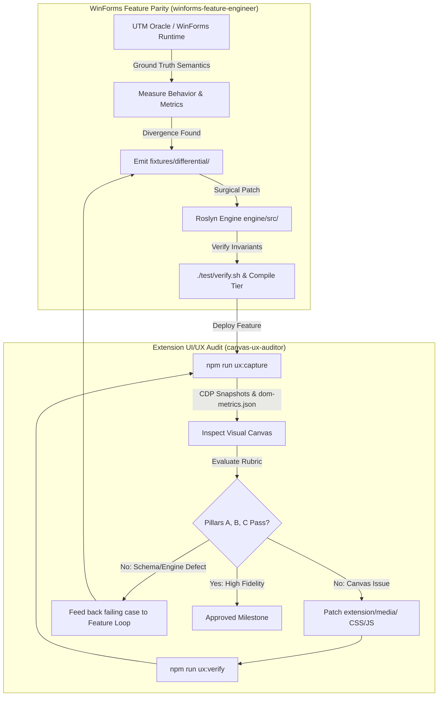

# Autonomous Parity & UI/UX Feedback Loop

This document specifies the dual-agent architecture that drives continuous Windows Forms feature parity and visual canvas quality in VSCForms.

---

## 1. Architecture: The Closed Feedback Loop

---

## 2. Defined Subagents

### `winforms-feature-engineer`
- **Role**: Discovers, measures, and implements Windows Forms features and control properties.
- **Tools**: QEMU guest agent (`scripts/utm-guest.sh`), project sync (`scripts/utm-vs-open.sh`), matrix runner (`scripts/run-windows-matrix.sh`), C# compiler.
- **Invariants**: Strictly enforces `AGENTS.md` Invariants 1–5 (source of truth is `.Designer.cs`, dialect preservation, BOM/CRLF byte-identity, no locked/refused writes, dual INSERT/REPLACE paths).

### `canvas-ux-auditor`
- **Role**: Drives headless Chrome DevTools Protocol (CDP) inside VS Code to capture high-res Dark and Light theme canvas renders.
- **Tools**: `npm run ux:capture`, `npm run ux:verify`, `node extension/test/hostHarness.js`.
- **Criteria**: Evaluates against `docs/ui-ux-review.md` (Pillar A: WinForms Control Aesthetic Fidelity; Pillar B: Canvas Ergonomics; Pillar C: VS Code Theme & Contrast Compliance).

---

## 3. How to Trigger the Loop

To run an iteration of the feature-to-UX loop:
1. Invoke `winforms-feature-engineer` on a specific feature queue item (e.g. Issue #65 default heights, #15 DateTimePicker formatting).
2. Once the engine passes unit tests, invoke `canvas-ux-auditor` to capture snapshots and verify the new control/property on the canvas.
3. If `canvas-ux-auditor` spots alignment, handle, or style defects, it patches `extension/media/` or feeds discrepancies back to the engine.
