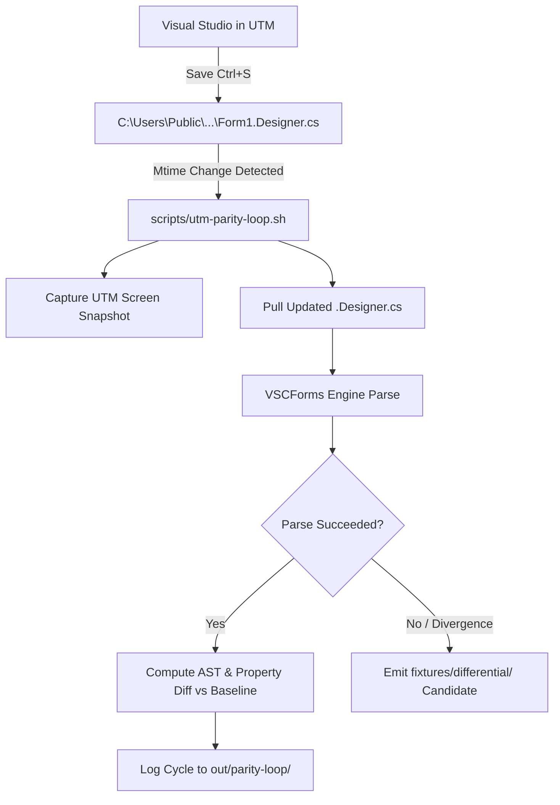

# Visual Studio Parity Loop Agent

The **Visual Studio Parity Loop Agent** continuously monitors the official Visual Studio Windows Forms Designer
running in a local UTM Windows VM, captures visual snapshots and emitted `.Designer.cs` code, evaluates VSCForms
engine parse and patch fidelity, and automatically identifies semantic divergences.

---

## 1. How It Works



---

## 2. CLI Usage

### Continuous Watch Loop
Monitors the guest file timestamp every 3 seconds. Whenever `Ctrl+S` is pressed in Visual Studio, it triggers a capture cycle:
```bash
scripts/utm-parity-loop.sh VSParitySandbox
```

### Single Inspection Cycle
Captures the current UTM screen state and pulls/parses the current `.Designer.cs`:
```bash
scripts/utm-parity-loop.sh --once VSParitySandbox
```

---

## 3. Subagent Integration (`vs-parity-oracle`)

A specialized agent type, `vs-parity-oracle`, is defined in the workspace:
- **Role**: Drives the UTM Visual Studio parity loop and differential verification.
- **Tools**: Access to guest execution (`scripts/utm-guest.sh`), staging tool (`scripts/utm-vs-open.sh`), and the parity loop (`scripts/utm-parity-loop.sh`).
- **Output**: Generates visual snapshots in `out/parity-loop/` and minimal differential fixtures in `fixtures/differential/` whenever divergence is detected.

---

## 4. Key Artifacts Produced
- `out/parity-loop/<project>/snapshot-<timestamp>.png`: Visual display capture of the Visual Studio designer.
- `out/parity-loop/<project>/Form1-<timestamp>.Designer.cs`: Full C# source written by Visual Studio.
- `out/parity-loop/<project>/analysis-<timestamp>.json`: Schema, coverage, and analysis output from the VSCForms Roslyn engine.
