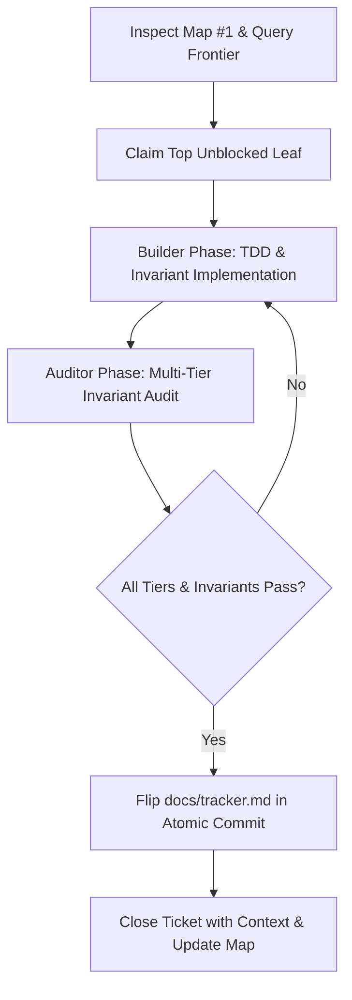
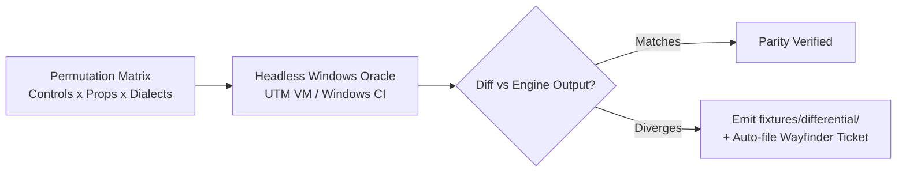

# Agentic Workflow & Differential Oracle Specification

Standard workflow specification for autonomous coding agents, invariant auditors, and the headless differential testing harness.

---

## 1. The Wayfinder Agent Loop

Autonomous agents working on VSCForms execute a disciplined, repeatable lifecycle grounded in GitHub Issues and the living tracker.



### Step 1: Query the Frontier
1. Read `docs/tracker.md` to establish current state.
2. Read the Wayfinder map ([#1](https://github.com/gOps132/VSCForms/issues/1)) and list open leaves via `gh issue list --state open`.
3. Filter out any tickets with open blockers (`issue_dependencies_summary.blocked_by > 0` or `Blocked by:` in issue body) or assignees.
4. The first unblocked leaf in map order is the active frontier.

### Step 2: Claim
1. Claim the ticket as the session's first write:
   ```bash
   gh issue edit <n> --add-assignee @me
   ```

### Step 3: Builder Phase (TDD & Invariant-Bound Implementation)
1. Write a failing regression fixture or unit test *before* editing engine or canvas code.
2. Comply strictly with Invariants 1–5 in `AGENTS.md`:
   - Never regenerate `InitializeComponent()`; emit surgical `TextChange`s only.
   - Match the file's observed dialect (`UsesThisPrefix`, delegate syntax vs. method group, qualified vs. bare).
   - Preserve CRLF/LF line endings and UTF-8 BOM.
   - Never write locked controls or refused forms.
   - Implement both REPLACE and INSERT paths for every property.

### Step 4: Auditor Phase (Independent Invariant Audit)
Before preparing a commit, an independent audit pass must run:
1. **Byte-level identity check**: verify untouched regions, line endings, and BOM preservation on edited files.
2. **Span audit**: run with `MF_DEBUG=1` to ensure only intended arguments and AST spans are touched (never type names, ADR 0005).
3. **Execution across verification tiers**:
   ```bash
   ./test/run-all.sh                    # Core suite + Roslyn invariants + WinForms compile
   node test/e2e.js                     # Full canvas -> host -> engine -> file loop
   node extension/test/hostHarness.js   # Canvas DOM harness
   ```

### Step 5: Atomic Tracker Sync
- Update `docs/tracker.md` **in the exact same commit** as the code change.
- Never ship an untracked feature or leave a shipped capability marked as `missing` or `partial`.

### Step 6: Close & Wayfinder Update
1. Close the issue with a concise summary linking to the commit:
   ```bash
   gh issue close <n> --comment "Completed in <commit-hash>: <summary>."
   ```
2. Update the parent map issue ([#1](https://github.com/gOps132/VSCForms/issues/1)) if child task lists or decisions changed.

---

## 2. Builder + Auditor Dual-Agent Protocol

For high-risk operations (cross-file code-behind generation, rename, container reparenting, dialect patching), the workflow employs a two-phase agent seam:

| Phase | Role | Responsibilities |
|---|---|---|
| **Builder** | Feature Implementer | - Writes minimal surgical Roslyn patches or canvas handlers.<br>- Implements exact dialect matching and typed refusal error kinds.<br>- Establishes initial test coverage. |
| **Auditor** | Invariant Verifier | - Verifies diffs strictly against `AGENTS.md` Invariants 1–5.<br>- Asserts byte-level preservation (CRLF/BOM via binary readers/hex inspection).<br>- Audits `MF_DEBUG=1` patcher spans to guarantee type names and untouched properties were not rewritten.<br>- Confirms real WinForms compile passes with zero warnings. |

---

## 3. Headless Differential Oracle (UTM & Windows CI)

To maintain semantic ground-truth parity with Visual Studio's Windows Forms Designer without introducing fragile, slow GUI automation or proprietary binary decompilation, VSCForms utilizes a **Black-Box Differential Testing Pipeline**.



### Core Architecture

1. **Clean-Room Black-Box Specification**:
   - The oracle measures Visual Studio / .NET runtime inputs $\to$ output C# code mutations, runtime `Bounds`, and event wiring conventions.
   - Runtime semantics reference the open-source `dotnet/winforms` codebase (MIT licensed).
   - Proprietary Visual Studio designer binaries are never decompiled.

2. **Headless Execution Substrate**:
   - Runs as a headless test runner / CLI daemon over SSH or local RPC.
   - **Portability**: Executes identically in a local macOS UTM Windows VM and on GitHub Actions native Windows CI runners (`windows-latest`).
     **Verified on both.** The UTM half runs the same matrix — 438 forms, 876 controls — in a
     Windows 11 ARM64 guest on Apple Silicon, and the renders it produces are **byte-identical**
     to the `windows-latest` ones. See #64 for the procedure and the traps.
   - Zero dependency on GUI mouse/keyboard automation or window focus.

3. **Deterministic Permutation Matrix**:
   - Test inputs are synthesized systematically across:
     - Handled controls (19 types)
     - Property permutations (`Font`, `BackColor`, `ForeColor`, `Items`, `ClientSize`, etc.)
     - Dialects (classic, templated, bare, this-style)
     - Container hierarchies (Form, Panel, GroupBox, TabControl/TabPage)

4. **Fixture-First Discrepancy Gate**:
   - When the differential oracle detects divergence between VSCForms and real Windows runtime/designer output:
     1. It automatically writes a minimal failing `.Designer.cs` fixture into `fixtures/differential/<issue-id>-<name>.Designer.cs`.
     2. It files a Wayfinder sub-issue with the exact observed diff.
     3. Patcher changes are only implemented *after* the reproduction fixture is committed.

---

## 4. Closed Dual-Agent Parity & UI/UX Feedback Loop

To bridge Windows Forms runtime semantics with the VS Code extension canvas, two specialized autonomous agents operate in a closed feedback loop:

1. **`winforms-feature-engineer`**:
   - Explores Windows Forms features and controls against the UTM Windows guest runtime (`scripts/utm-guest.sh`, `scripts/utm-vs-open.sh`).
   - Identifies semantic divergences and writes reproduction fixtures in `fixtures/differential/`.
   - Surgically adapts the Roslyn engine (`engine/src/Patcher.cs`, `TypeTable.cs`) under Invariants 1–5.
   - Verifies with `./test/verify.sh` and `./test/verify-differential-matrix.sh`.

2. **`canvas-ux-auditor`**:
   - Inspects the VS Code visual designer canvas via headless CDP capture (`npm run ux:capture`, `npm run ux:verify`).
   - Evaluates visual fidelity against `docs/ui-ux-review.md` (Pillar A: WinForms Aesthetics, Pillar B: Canvas Ergonomics, Pillar C: Theme Contrast).
   - Feeds bounding rectangle, handle, or style discrepancies directly back to the feature engineer, or surgically patches `extension/media/`.

See `docs/agents/parity-feedback-loop.md` for full agent specifications and invocation procedures.
